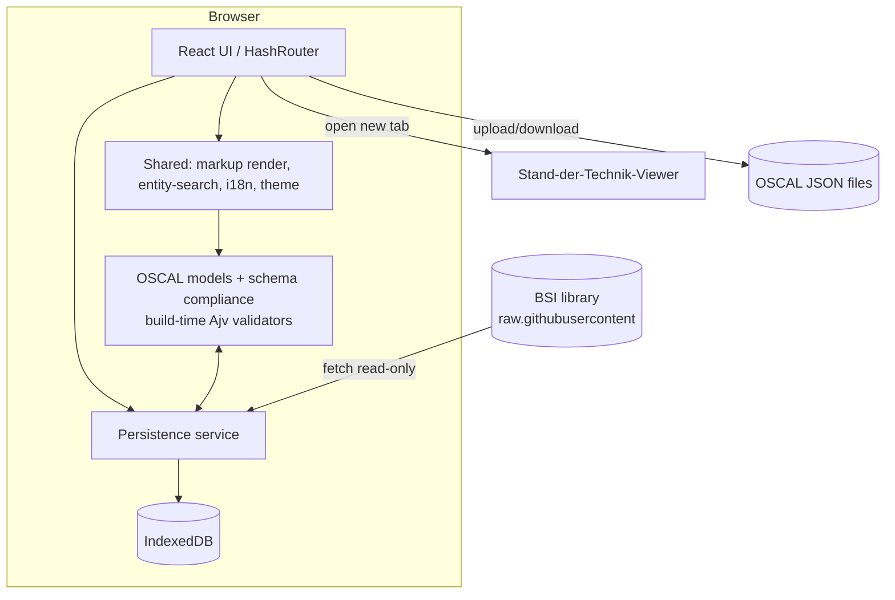
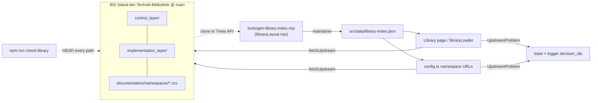

# TALOS — Technical Design

> **TALOS** — Trust and Assessment Lifecycle for Organizational Security.
> A **static, client-side** web app (GitHub Pages) for the OSCAL-based compliance workflow.
> This document is the technical anchor; every decision here traces to an ADR
> (`decision_ids`). See `docs/adr_registry.md`.

**Status:** Draft (pending principal-engineer review, T-017) · **Date:** 2026-07-02

---

## 1. Purpose & scope

TALOS lets users create, edit, and run compliance workflows over OSCAL artifacts entirely in
the browser. Priority capabilities: **component-definitions** and **SSPs**, reachable from a
**landing page**, using OSCAL sources that are either **uploaded** by the user or drawn from the
**BSI Stand-der-Technik-Bibliothek** (read at startup).

**In scope (v1):** landing page; component-definition and SSP CRUD + OSCAL round-trip; profile
CRUD (control tailoring); BSI library browse/adopt; upload/download + workspace export/import;
management dashboard; two assistants. **Deferred:** full editors for assessment-plan /
assessment-results / POA&M (round-trip + read view first, P2); PWA/offline; multi-version OSCAL
conversion; File System Access API.

---

## 2. Architecture overview `[ADR-0002]`

Single-page **React + TypeScript** app built by **Vite** to static assets, deployed to
**GitHub Pages** via GitHub Actions. No backend, no database. Only external network call:
read-only fetch of the BSI library `[ADR-0005]`. User data stays on-device in **IndexedDB**
`[ADR-0004]`.



**Layered structure**

| Layer | Modules | Responsibility |
|---|---|---|
| **UI** | `src/features/*`, `src/app/` (shell, router, landing) | Views, editors, navigation `[ADR-0002,0006]` |
| **Shared** | `src/shared/*` | markup render `[ADR-0009]`, entity-search `[ADR-0013]`, i18n `[ADR-0012]`, theme/tokens `[ADR-0010]`, symbols `[ADR-0011]`, logging |
| **Domain** | `src/models/*` | OSCAL base + per-type models, codecs, export document, compliance model + lazily loaded schema validators `[ADR-0003,0007,0040]` |
| **Data** | `src/data/*` | IndexedDB repositories, file I/O, library loader `[ADR-0004,0005]` |
| **State** | `src/stores/*` (Zustand) | UI/workspace state synced to repositories |

---

## 3. Technology stack & dependencies

| Concern | Choice | Notes |
|---|---|---|
| Language | TypeScript | Strict mode |
| UI | React 18 | Function components + hooks |
| Build | Vite | `base: '/talos/'` for Pages |
| Routing | React Router **HashRouter** | Static-host deep links `[ADR-0002]` |
| State | **Zustand** | Light stores, IndexedDB-synced (Q5) |
| Schema validation | **Ajv 8 standalone code**, generated at build time (`tools/oscalValidators.mjs`, Vite/Vitest plugin, `virtual:oscal-validator/<type>`) — no runtime compilation (CSP) | Vendored NIST OSCAL v1.2.3 JSON schemas (draft-07), `schemas/oscal/1.2.3/` + `MANIFEST.json` (sha256) `[ADR-0040]` |
| Persistence | **IndexedDB** (`idb` wrapper) | `[ADR-0004]` |
| Zip (workspace bundle) | a small zip lib (e.g. `fflate`) | export/import-all (Q8) |
| Markdown | dependency-free renderer (optionally `marked`+`DOMPurify`, constrained) | `[ADR-0009]` |
| Charts (Management Dashboard) | **Recharts** | SVG-based, composes with ADR-0010 CSS tokens directly `[ADR-0034]` |
| Tests | Vitest + React Testing Library; Playwright (E2E); `runner.py` (YAML/golden) | `[ADR-0001]` |

Dependency manifest lives in `package.json` (T-023); Python-side harness deps in
`tests/test_harness/requirements.txt`.

---

## 4. OSCAL data model `[ADR-0003, ADR-0007]`

Shared **`OscalArtifact`** base (`uuid`, `metadata`, `back-matter`) extended per type:
`Profile`, `ComponentDefinition`, `SystemSecurityPlan`, `AssessmentPlan`, `AssessmentResults`,
`PlanOfActionAndMilestones`. See ADR-0003 for the type sketch.

- **Envelope codec:** maps the single-key OSCAL wrapper (`{"component-definition": …}`) ⇄ typed
  model in one place.
- **Shared sub-models & editors:** metadata (roles/parties/props/links/revisions/document-ids),
  back-matter (resources/rlinks/citations), props/links helpers, document-ids (bare-uuid scheme).
- **Validation (ADR-0040):** one notion of "valid" — an artifact is *compliant* when its export
  document (`buildExportDocument`: oscal-version normalized, empty arrays dropped, `"$schema"`
  first) validates against the vendored NIST 1.2.3 JSON schema of its model (catalog, profile,
  component-definition, SSP; other models are `unchecked`). `src/models/compliance.ts` turns Ajv
  errors into issues (JSON pointer, OSCAL path with numbered items + hints, reason code + params),
  `src/data/complianceCheck.ts` runs and memoizes checks, logs and counts them; the UI
  (`src/features/shared/compliance/`) renders badges, issue lists, the draft-export dialog and the
  blocked-input notice, all localized (`src/shared/complianceMessages.ts`). Uploads/adoptions are
  validated but never rejected for schema reasons (flagged instead).
  Authoring/export = **v1.2.3** (`OSCAL_AUTHORING_VERSION`, single source); import accepts any
  1.x without auto-conversion: other 1.2.x patches silently (info log), 1.0/1.1/other minors and a
  missing version with a localized warning, non-1.x rejected. Upload and library adopt share one
  policy helper (`src/data/importVersionPolicy.ts`, outcome counters) `[ADR-0007 amended 2026-11-16]`.
  Component-type suggestions follow the NIST 1.2.3 list (15 values) with localized descriptions
  (`src/models/componentTypes.ts`).
- **Control references:** IDs resolved to titles when the catalog is cached; full viewing is
  offloaded to the external viewer `[ADR-0008]`.
- **Composition:** component-definitions compose others via `import-component-definition` —
  resolved/unresolved refs, cycle protection, read-only transitive view, back-matter reference
  export `[ADR-0014]`; a core part of the priority component-definition feature (IMPL-001).
- **Fidelity:** unknown-but-spec-allowed fields (props/links/remarks) preserved on round-trip;
  unresolved cross-artifact refs kept verbatim, never dropped `[ADR-0014]`.

---

## 5. Persistence & data flow `[ADR-0004]`

**IndexedDB `talos`** — object stores: `profiles`, `componentDefinitions`, `ssps`,
`assessmentPlans`, `assessmentResults`, `poams`, `libraryCache`, `unresolvedReferences`,
`settings`, `assets`, `assetTypes`, `targetObjectCategoryCache` (ADR-0026),
`threatCatalogCache` (ADR-0035). Each artifact record carries `origin`
(`user` | `imported` | `library`), `createdAt`, `updatedAt`.

**Flows**
- *Create/edit* → Zustand store → repository `put` → IndexedDB (draft-friendly; validation is
  non-blocking, run on demand + before export, Q6).
- *Upload* → envelope codec → store as `origin: imported` (uuid collision → import-as-copy) →
  schema check; non-compliant → warning toast, badge, blocked as workflow input `[ADR-0040]`.
- *Download* → export document (`$schema`, normalized version, no empty arrays) → creator rule
  (blocks, ADR-0019) → schema check: compliant downloads at once, non-compliant only as a draft
  after a dialog naming every non-compliant field; filename `<type>-<title-slug>-<uuid8>.json`.
- *Use as input* (profile → SSP, catalog/profile → profile/assistants/bootstrap/component-definition
  source, component-definition → SSP/component-definition) → **compliance gate**: only compliant
  artifacts; consumption points G1–G8 in ADR-0040 §6.
- *Export/Import all* → **zip + `manifest.json`**, each entry standalone OSCAL (Q8).
- *Library* → loader fetches BSI content, caches in `libraryCache` (read-only) `[ADR-0005]`.

**Durability:** request `navigator.storage.persist()`; surface quota via `storage.estimate()`;
on quota error, warn + guide to export, never drop data.

---

## 6. BSI library integration `[ADR-0005, ADR-0008, ADR-0039]`

- **Source:** BSI's **live `main`** branch via `raw.githubusercontent.com` (PO decision Q1,
  ADR-0039); paths percent-encoded per segment (`libraryRawUrl`).
- **Manifest:** bundled `src/data/library-index.json`, generated by `tools/gen-library-index.mjs`
  (`--clone <dir>` from a local clone, or the GitHub Trees API) using the layout rules in
  `tools/libraryLayout.mjs`. Records `{ref, commit, namespaces, entries[{path, artifactType, title,
  category, sha, size}]}`; `commit`/`sha` are the generating upstream state (informational, cache
  keys), not a content pin.
- **Upstream layout → categories (ADR-0039 §2):** `control_layer/**-resolved_catalog.json` and
  standalone catalogs → **Anwenderkatalog**; catalogs imported by a BSI profile → **Quellkatalog**;
  `-profile.json` → **Profil**; `implementation_layer/**-component_definition.json` →
  **Komponente**; `-mapping_collection.json` → **Mapping** (listed, "not supported yet", PO Q11);
  assessment-layer suffixes → **Assessment** (anticipated). Default view: Anwenderkataloge +
  Komponenten; everything else behind the advanced toggle. Adoptable kinds: catalog, profile,
  component-definition.
- **Namespaces:** `target_object_categories.csv` (ADR-0026) and `basethreats.csv` (ADR-0035) are
  located by file name at generation time and stored in the manifest's `namespaces`;
  `src/config.ts` derives their URLs and validates them at boot.
- **Startup:** load the *index* at start; fetch artifact bodies lazily on adopt; cache by
  `path`+`sha` (`libraryCache`).
- **Failure handling:** shared `src/data/upstreamFetch.ts` (see §8); a failure is a structured
  `UpstreamProblem`, logged with `decision_ids` and shown as a localized toast
  (`src/shared/upstreamMessages.ts`).
- **Drift check:** `npm run check:library` (network, opt-in, not CI) verifies every indexed path
  and namespace URL still returns 200 on `main`; on failure regenerate the index and redeploy.
- **Provenance:** `origin: library`, read-only, muted-green dashed badge `[ADR-0010]`; **adopt**
  copies into the workspace as `origin: user` with a new `uuid` for tailoring. A root `"$schema"`
  key in a BSI file is ignored on parse.
- **Catalog viewing:** offloaded to the external Stand-der-Technik-Viewer `[ADR-0008]`.
- **Attribution:** CC-BY-SA-4.0 surfaced in the library browser + README.



---

## 7. UI & navigation `[ADR-0006, ADR-0010, ADR-0011, ADR-0012]`

- **Shell:** HashRouter, top nav, theme toggle (`data-theme`, no media queries), i18n provider
  (**default German**, en available — Q9), toast/error surface.
- **Landing page** `[ADR-0006]`: cards for every feature grouped by OSCAL layer
  (control=blue, implementation=green **[priority: component-defs, SSPs]**, assessment=amber),
  assistants (✦), dashboard, and data (library/upload/export). Cards show per-type artifact
  counts + empty-state guidance.
- **Editors:** hand-built bespoke editors for priority artifacts (Q4), reusing the shared
  metadata/back-matter panels; no generic schema-form dependency.
- **Shared widgets:** markup renderer `[ADR-0009]`, entity-search over IndexedDB `[ADR-0013]`,
  symbol set `[ADR-0011]`.
- **Management Dashboard** (`/dashboard`, `[ADR-0034]`): one page, one section per tile in
  mission-statement order (Risk Coverage, Control Coverage, Assessment State). Both Risk Coverage
  (T-400, `[ADR-0035]`) and Control Coverage (T-401) are live: each is a pure aggregation module
  (`riskCoverage.ts` / `controlCoverage.ts`, no React/Recharts import) + a Recharts chart + a
  collapsed-by-default per-SSP breakdown table (`<CollapsibleSection>`). Control Coverage's chart
  is a per-control worst-status-wins bar chart of workspace totals; Risk Coverage's is a pie
  chart of workspace **averages** (sum-across-SSPs ÷ SSP-count per bucket) — coverage is computed
  independently per SSP, since a threat can be fully handled by one system and unaddressed by
  another. Assessment State still renders the disabled "coming soon" placeholder T-040
  established for not-yet-built landing features, until T-402 lands.

---

## 8. Error handling, retry & observability `[ADR-0002]`

- **Config validation at startup:** a typed config schema is validated; invalid config fails
  fast with a clear **red** error (T-025).
- **BSI upstream fetch** (library artifacts + both namespace CSVs, `src/data/upstreamFetch.ts`):
  timeout + retry with backoff for network errors/5xx/408/429; other 4xx (a moved file → 404)
  fail immediately; degrade to cache with a **yellow** warning that says whether the file moved
  or the network failed; with no cache, raise `UpstreamLoadError` → **red** toast naming the
  resource and URL. Logged with `decision_ids [ADR-0039, ADR-0005]` and counted
  (`getUpstreamStats()`) `[ADR-0005, ADR-0039]`. Every live-fetch call site has a `.catch`; an
  `unhandledrejection` logger in `main.tsx` is the safety net.
- **Logging:** structured (JSON-shaped) log records via a logging util, each including
  `decision_ids` (ADR IDs), with an in-app ring buffer for diagnostics; **warnings yellow,
  errors red** in console + toasts.
- **Validation errors (ADR-0040):** non-blocking compliance badge + issue list per artifact (list
  rows, detail pages, editors — drafts debounced); at export the draft dialog is the explicit
  override path; the ADR-0019 creator rule is the only hard export blocker; workflow inputs are
  gated (fail closed). Logged with `decision_ids: ["ADR-0040"]`, counted by `getComplianceStats()`.

---

## 9. Security `[ADR-0002, ADR-0009, ADR-0030]`

- **XSS:** all OSCAL markup rendered through the single sanitizing renderer (HTML-escape →
  subset → link-URL allowlist); no raw HTML, no images `[ADR-0009]`. The subset now covers the
  full metaschema markup-line/markup-multiline set — headings, nested lists, code blocks,
  blockquotes, tables, specialized-character escaping, parameter-insertion placeholders — images
  stay excluded on the same XSS grounds `[ADR-0030]`.
- **Safe parsing:** uploaded JSON parsed defensively + schema-validated before use.
- **External links / hand-off:** `rel="noopener"` new-tab; viewer receives only public URLs.
- **Privacy:** no telemetry, no third-party calls except the read-only BSI fetch; all user data
  on-device.
- Full security notes in `docs/security.md` (T-016); security review T-502.

---

## 10. Performance budgets `[ADR-0002]`

| Metric | Budget (initial target) |
|---|---|
| App shell JS (gzip) | ≤ 250 KB |
| Time-to-interactive (landing, mid device) | ≤ 2.5 s |
| Open a large catalog/component-def render | ≤ 500 ms after fetch |
| IndexedDB list query (typical workspace) | ≤ 50 ms |

Techniques: route-level code splitting (the dashboard route and the per-model schema validators
are lazy chunks, ADR-0040), virtualized long lists, memoized markup rendering, incremental search
index. Tracked in `docs/performance.md` (T-016; ADR-0040 bundle/validation figures), verified T-503.

---

## 11. Configuration schema `[ADR-0002, ADR-0004]`

Runtime config, validated at startup — **built (T-025)**, `src/config.ts`:

```ts
interface TalosConfig {
  basePath: string;                 // Vite base, e.g. "/talos/" — a plain constant, not
                                     // import.meta.env.BASE_URL, since e2e specs import this
                                     // module directly under Node (no Vite env replacement there)
  library: {
    rawBase: string;                // raw.githubusercontent base, live `main` (ADR-0039)
    namespaces: {                   // repo-relative CSV paths, from library-index.json (ADR-0039)
      targetObjectCategories: string;
      threats: string;
    };
  };
  viewerUrl: string;                // Stand-der-Technik-Viewer base
  defaultLanguage: 'de' | 'en';     // 'de'
  oscalVersion: string;             // must equal OSCAL_AUTHORING_VERSION ('1.2.3')
  backMatter: {
    maxEmbeddedFileBytes: number;   // hard limit for base64-embedded files (default 5 MiB, ADR-0015)
  };
}
```

`validateConfig(config)` returns every violation found (not just the first); `main.tsx` calls it
against the single `TALOS_CONFIG` instance before mounting React. On failure it logs a structured
error (`src/shared/logger.ts`) and renders a plain-DOM fail-fast error screen
(`src/app/bootError.ts`) instead of the app — **fail fast, red error, halt boot**. The original
draft's `library.manifestUrl`/`liveRefresh`/`includeSourceCatalogs` fields were dropped from the
schema: nothing reads them yet (the library manifest is a bundled JSON import, and the
live-refresh/advanced-toggle defaults are still local component state) — adding validated-but-unused
config knobs would be premature; they can return if/when the library feature is refactored to
consume `TalosConfig`.

**Structured logging** (`src/shared/logger.ts`): `createLogger(version)` returns a logger whose
every record is `{ timestamp, level, message, decisionIds, version, context? }` — JSON-shaped,
carrying ADR references and the running app version (injected at build time from `package.json`
via `define: { __APP_VERSION__ }` in `vite.config.ts`/`vitest.config.ts`). Console output routes
to `console.info`/`warn`/`error` styled amber/red per ADR-0010's tokens; a capped 200-record
in-memory ring buffer stands in for a rotating file handler (there is no filesystem in a static,
client-side app) and is available for a future in-app diagnostics view. The app-wide singleton is
`src/shared/logger.ts`'s exported `logger`. BSI upstream failures (library + namespaces) log through it since ADR-0039; other pre-existing
warn/error paths (e.g. `fileIo`'s import warnings) are not yet retrofitted — follow-up work.

---

## 12. Testing strategy `[ADR-0001]`

- **Unit/component** (Vitest + RTL): codecs, validators, renderer, search, editors.
- **Golden round-trip:** `import(json) → model → export(json)` deep-equals, per artifact type,
  fixtures in `tests/data/` (incl. sanitized BSI samples with attribution).
- **Contract/schema (ADR-0040):** golden fixtures validated with the production validators
  (TEST-SCHEMA-02: valid fixtures + deliberately invalid ones with golden `.expected.json`
  compliance reports); valid-by-construction contract for every factory/assistant/editor path
  (TEST-SCHEMA-06); harness `schema-snapshot` checks the vendored schemas' sha256 and `$id`.
- **E2E** (Playwright): landing → adopt-from-library → edit component-def/SSP → download.
- **YAML harness** (`tests/test_harness/runner.py`): executes `tests/tests.yaml`, validates
  golden/schema, emits JSON logs + JUnit XML.
- **CI gate:** full suite blocks the Pages deploy `[ADR-0002]`.

---

## 13. Deployment `[ADR-0002]`

GitHub Actions: `npm ci` → lint + typecheck + **tests (gate)** → `vite build` → deploy `/dist`
to Pages (`actions/deploy-pages`). `404.html` = `index.html` copy for non-hash fallback.

---

## 14. Open design uncertainties

1. ~~**Threat/risk dashboard field**~~ — **Resolved (ADR-0035, T-400):** `controls > props >
   name:"threats"` is live — 899/998 Grundschutz++ controls carry it, comma-separated threat IDs
   referencing `basethreats.csv` in the BSI namespace folder, exactly as anticipated. Loader
   mirrors the target-object-category namespace CSV loader (item 4 below).
2. **External viewer deep-linking** — no per-control URL API today; revisit if the viewer adds
   one `[ADR-0008]`.
3. **Multi-version OSCAL conversion** — deferred; revisit if BSI/user files diverge from 1.2.3
   materially `[ADR-0007]`.
4. ~~**Assistant SSP-bootstrap input format**~~ — **Resolved (ADR-0026, T-301):** 3-file CSV asset
   list matching the golden `recplast` shape; target-object-category hierarchy live-fetched from
   the BSI namespace CSV.

---

## 15. Traceability

Every section maps to ADRs (bracketed `decision_ids`) and to `todo.md` tickets; features are
tracked in `docs/feature_registry.yaml` with linked test IDs. Principal-engineer review of this
design + all ADRs is **T-017** (gate before implementation).
